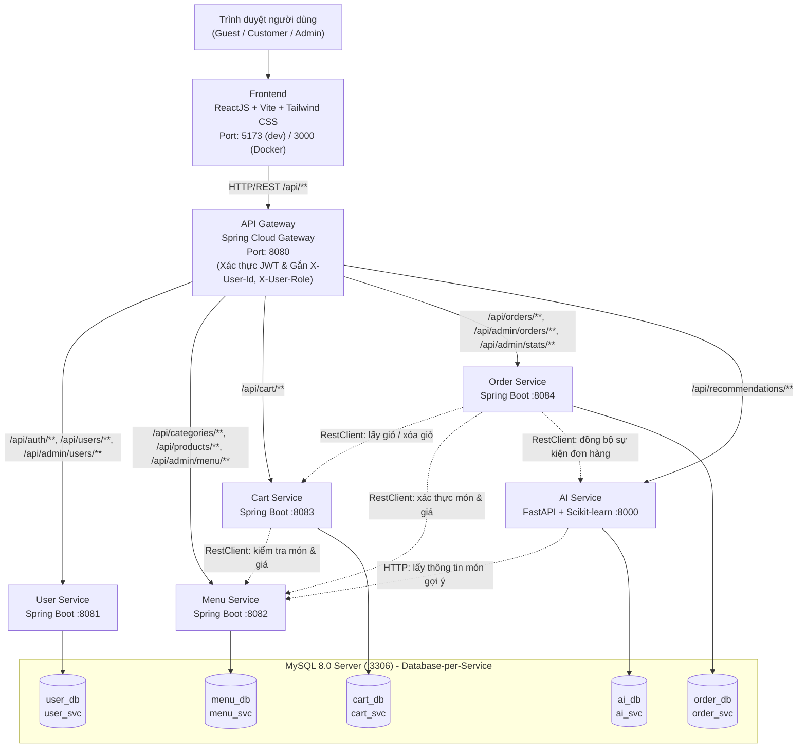

# KIẾN TRÚC HỆ THỐNG FOODHUB

Tài liệu này mô tả kiến trúc tổng thể, danh sách phiên bản công nghệ đã chốt, nhiệm vụ từng Microservice, luồng giao tiếp, cấu hình cơ sở dữ liệu, quy ước cổng chạy và mạng Docker cho hệ thống thương mại điện tử bán đồ ăn trực tuyến **FOODHUB**.

---

## 1. Kiến trúc tổng thể (Microservices Architecture)

FOODHUB được thiết kế theo mô hình **Microservices** tinh gọn, tối ưu cho máy cá nhân, bao gồm **1 Frontend**, **1 API Gateway**, **5 dịch vụ độc lập** (4 Spring Boot + 1 FastAPI AI) và **1 MySQL Server** chia thành **5 database logic** theo nguyên tắc **Database-per-Service**.



---

## 2. Phiên bản công nghệ đã chốt (Thống nhất toàn dự án)

| Nhóm công nghệ | Công nghệ | Phiên bản chốt | Ghi chú tương thích |
|---|---|---|---|
| **Backend Runtime** | Java JDK | **21 LTS** | Yêu cầu bắt buộc của `SPEC.md` |
| **Backend Build** | Apache Maven | **3.9.x** | Dùng chung cho 5 dự án Spring Boot |
| **Backend Framework** | Spring Boot | **3.3.5** | Tương thích hoàn toàn JDK 21 |
| **API Gateway** | Spring Cloud Gateway | **2023.0.3** (Leyton) | Khớp tương thích với Spring Boot 3.3.x |
| **Bảo mật Backend** | Spring Security + JJWT + BCrypt | Security **6.3.x**, JJWT **0.12.6** | Xác thực JWT tập trung tại Gateway |
| **Giao tiếp nội bộ** | RestClient / WebClient | Tích hợp Spring 6 | Không dùng Eureka/Consul |
| **Frontend Runtime** | Node.js & npm | **Node.js 22/24 LTS** (máy hiện tại: `v24.21.0`, npm `11.19.0`) | Tương thích Vite 6 |
| **Frontend Core** | React + Vite | **React 18.3.1**, **Vite 6.x** | Ổn định, build nhanh |
| **Frontend UI & Routing** | Tailwind CSS, React Router, Axios | **Tailwind 3.4.x**, **React Router 6.28.x**, **Axios 1.7.x** | Quản lý state bằng Context API |
| **AI Service** | Python, FastAPI, Uvicorn, Scikit-learn | **Python 3.11**, **FastAPI 0.115.x**, **Scikit-learn 1.5.x** | Docker base: `python:3.11-slim` |
| **Cơ sở dữ liệu** | MySQL | **8.0** (`mysql:8.0`) | Charset `utf8mb4_unicode_ci` |
| **Web Server / Deploy** | Nginx, Docker, Docker Compose | **Nginx 1.27-alpine**, **Docker Compose v2+** | Chạy ổn định trên máy cá nhân |

---

## 3. Bảng chốt cổng chạy và định danh dịch vụ

| Thành phần | Tên Service (Docker) | Container Name | Cổng Container | Cổng Host (Local) | URL nội bộ Docker |
|---|---|---|---|---|---|
| **Frontend (Dev)** | `frontend` | `foodhub-frontend` | `5173` (dev) / `80` (prod) | `5173` (dev) / `3000` (Docker) | `http://frontend:80` |
| **API Gateway** | `api-gateway` | `foodhub-api-gateway` | `8080` | `8080` | `http://api-gateway:8080` |
| **User Service** | `user-service` | `foodhub-user-service` | `8081` | `8081` | `http://user-service:8081` |
| **Menu Service** | `menu-service` | `foodhub-menu-service` | `8082` | `8082` | `http://menu-service:8082` |
| **Cart Service** | `cart-service` | `foodhub-cart-service` | `8083` | `8083` | `http://cart-service:8083` |
| **Order Service** | `order-service` | `foodhub-order-service` | `8084` | `8084` | `http://order-service:8084` |
| **AI Service** | `ai-service` | `foodhub-ai-service` | `8000` | `8000` | `http://ai-service:8000` |
| **MySQL Server** | `mysql` | `foodhub-mysql` | `3306` | `3306` | `mysql:3306` |

---

## 4. Nhiệm vụ của từng thành phần

### 4.1. Frontend (`frontend/`)
- Cung cấp giao diện tiếng Việt, đơn vị tiền tệ **VNĐ**, responsive cho 3 nhóm người dùng: **Khách vãng lai (Guest)**, **Khách hàng (Customer)** và **Quản trị viên (Admin)**.
- Mọi lời gọi API đều đi qua duy nhất **API Gateway** (`VITE_API_BASE_URL`).

### 4.2. API Gateway (`backend/api-gateway/`)
- Cổng vào duy nhất cho toàn bộ hệ thống Backend (cổng `8080`).
- Định tuyến request đến các service bằng URL cấu hình qua biến môi trường (không dùng Eureka/Consul).
- Xử lý CORS tập trung cho Frontend.
- Xác thực **JWT Token** cho các route yêu cầu đăng nhập; giải mã và gắn thông tin vào HTTP Header:
  - `X-User-Id`: ID người dùng đang đăng nhập.
  - `X-User-Role`: Vai trò (`CUSTOMER` hoặc `ADMIN`).
- Chặn và loại bỏ các header giả mạo từ client trước khi chuyển tiếp xuống service con.

### 4.3. User Service (`backend/user-service/`) — DB: `user_db`
- Đăng ký, đăng nhập, mã hóa mật khẩu bằng **BCrypt**, cấp phát **JWT Token**.
- Quản lý hồ sơ cá nhân (xem, cập nhật thông tin, đổi ảnh đại diện).
- Chức năng Admin: xem danh sách, tìm kiếm, cập nhật, phân quyền và xóa người dùng (không trả về mật khẩu gốc).

### 4.4. Menu Service (`backend/menu-service/`) — DB: `menu_db`
- Quản lý danh mục món ăn và danh sách món ăn (hình ảnh, mô tả, giá bán VNĐ, trạng thái kinh doanh).
- Hỗ trợ tìm kiếm theo tên, lọc theo danh mục, xem chi tiết món ăn (công khai cho Guest và Customer).
- Chức năng Admin: thêm, sửa, xóa danh mục và sản phẩm, cập nhật trạng thái kinh doanh.

### 4.5. Cart Service (`backend/cart-service/`) — DB: `cart_db`
- Quản lý giỏ hàng gắn với từng tài khoản Customer (`X-User-Id`).
- Thêm món, cập nhật số lượng, xóa món, xóa toàn bộ giỏ hàng sau khi đặt hàng thành công.
- Gọi **Menu Service** qua `RestClient` để xác thực món ăn còn kinh doanh và lấy thông tin giá chính xác.

### 4.6. Order Service (`backend/order-service/`) — DB: `order_db`
- Tạo đơn hàng từ giỏ hàng, lưu thông tin người nhận, snapshot giá món tại thời điểm đặt.
- Customer: xem lịch sử đặt hàng, chi tiết đơn hàng, theo dõi trạng thái xử lý (chỉ xem đơn của chính mình).
- Admin: xem danh sách/chi tiết đơn hàng, cập nhật trạng thái đơn, thống kê Dashboard, doanh thu và món ăn bán chạy theo tháng.
- Sau khi tạo đơn, gửi yêu cầu xóa giỏ hàng tới **Cart Service** và đồng bộ dữ liệu tương tác/đặt hàng tới **AI Service**.

### 4.7. AI Service (`ai-service/`) — DB: `ai_db`
- Xây dựng bằng **FastAPI + Scikit-learn**.
- Lưu trữ lịch sử tương tác (xem món, thêm giỏ, đặt hàng) kèm khung giờ truy cập trong `ai_db`.
- Đề xuất danh sách món ăn cá nhân hóa cho Customer dựa trên lịch sử đặt hàng, hành vi tương tác và khung giờ trong ngày (sáng, trưa, chiều, tối).

---

## 5. Luồng giao tiếp & Chuẩn API

### 5.1. Luồng xác thực & phân quyền
1. Client gửi `Authorization: Bearer <jwt_token>` đến **API Gateway**.
2. Với các endpoint công khai (đăng ký, đăng nhập, xem thực đơn/danh mục, chi tiết món ăn), API Gateway chuyển tiếp trực tiếp.
3. Với các endpoint cần đăng nhập:
   - API Gateway xác thực chữ ký và thời hạn JWT.
   - Nếu hợp lệ, API Gateway gắn `X-User-Id` và `X-User-Role` vào request header và chuyển tiếp xuống service tương ứng.
   - Service con đọc `X-User-Id` và `X-User-Role` để kiểm tra quyền vai trò (`CUSTOMER` / `ADMIN`) và quyền sở hữu dữ liệu.

### 5.2. Chuẩn JSON phản hồi thống nhất
Mọi API của FOODHUB (cả thành công và lỗi) đều trả về cấu trúc JSON thống nhất theo `SPEC.md`:

```json
{
  "success": true,
  "message": "Thông báo tiếng Việt",
  "data": {}
}
```

---

## 6. Kiến trúc Cơ sở dữ liệu (Database-per-Service)

Hệ thống dùng **1 MySQL 8.0 Server** duy nhất để tối ưu RAM trên máy cá nhân, nhưng tách biệt hoàn toàn về mặt logic và phân quyền:

| Database | Tài khoản MySQL | Microservice sở hữu | Ghi chú |
|---|---|---|---|
| `user_db` | `user_svc` | `user-service` | Chỉ `user_svc` có quyền truy cập `user_db` |
| `menu_db` | `menu_svc` | `menu-service` | Chỉ `menu_svc` có quyền truy cập `menu_db` |
| `cart_db` | `cart_svc` | `cart-service` | Chỉ `cart_svc` có quyền truy cập `cart_db` |
| `order_db` | `order_svc` | `order-service` | Chỉ `order_svc` có quyền truy cập `order_db` |
| `ai_db` | `ai_svc` | `ai-service` | Chỉ `ai_svc` có quyền truy cập `ai_db` |

- Toàn bộ database sử dụng `CHARACTER SET utf8mb4 COLLATE utf8mb4_unicode_ci` để lưu trữ tiếng Việt có dấu và emoji.
- **Tuyệt đối không** truy vấn chéo giữa các database; mọi nhu cầu dữ liệu từ service khác đều đi qua REST API nội bộ.
- File `database/init.sql` chỉ khởi tạo 5 database và 5 user phân quyền; từng service tự quản lý bảng và dữ liệu mẫu riêng.

---

## 7. Quy ước mạng Docker

- Tất cả các container của FOODHUB tham gia cùng một bridge network riêng mang tên **`foodhub-network`**.
- Các service giao tiếp nội bộ bằng **tên service Docker** (ví dụ: `http://menu-service:8082`, `mysql:3306`) thông qua biến môi trường.
- Dữ liệu MySQL được lưu trữ bền vững trong Docker named volume **`foodhub-mysql-data`** (`mysql_data`), không mất dữ liệu khi restart container.
